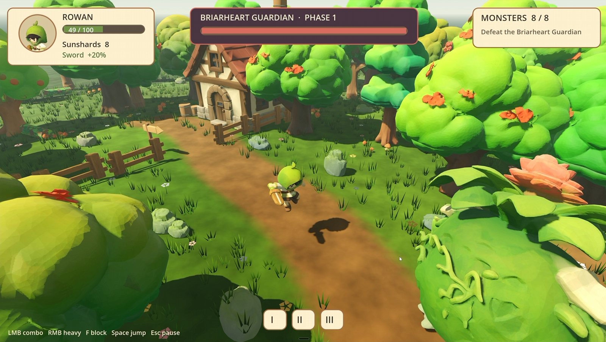
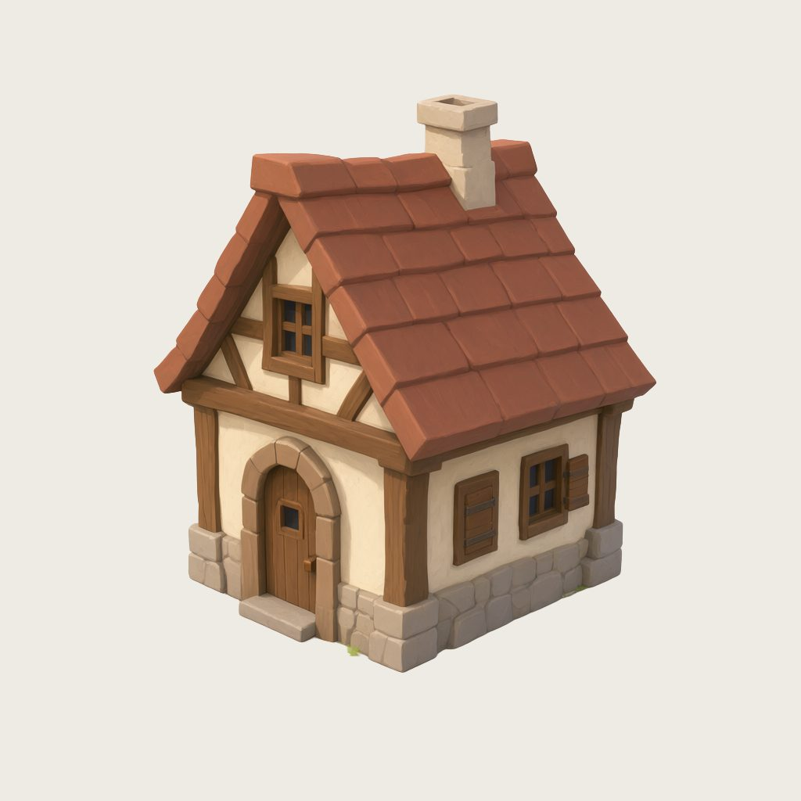
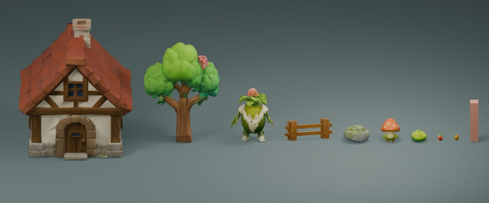
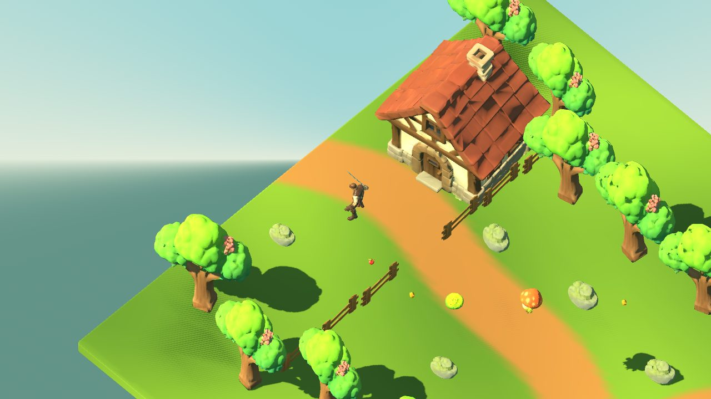
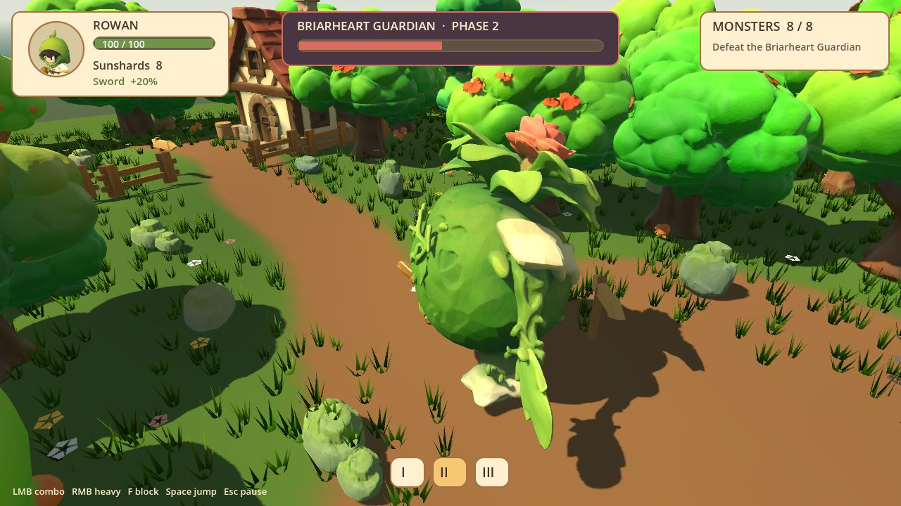

# PixelArtistry · Kimi Game Pipeline

Rebuild the setup from my video **"I Created My Own Game with Kimi K3.1 Using Only Local 3D AI (Godot + Blender)"**: Kimi K3.1 Pro in Kimi Code controls ComfyUI, Blender and Godot through MCP, and every image and 3D asset is generated locally on Windows.

> [!NOTE]
> This video is sponsored by Moonshot AI, the company behind Kimi. The guide and my opinions are my own.

▶ **The full story, with screenshots:** https://pixel-artistry.com/blog/kimi-game-pipeline/
▶ **Full guide:** https://pixelartistry.github.io/PixelArtistry-Kimi-Game-Pipeline/
▶ **Video:** TODO: add the video link · [PixelArtistry on YouTube](https://www.youtube.com/@PixelArtistry_)



## From concept to game

| Concept | 3D props | First level | Finished game |
|---|---|---|---|
|  |  |  |  |

More work-in-progress and final screenshots are in the [guide](https://pixelartistry.github.io/PixelArtistry-Kimi-Game-Pipeline/#screenshots).

## The pipeline

```
                 Kimi K3.1 Pro in Kimi Code  (reads my prompts, drives the apps through MCP)
                   │               │                 │                  │
                   ▼               ▼                 ▼                  ▼
  Concept images ──► Image to 3D ──────► Blender cleanup ──► Godot game
  Qwen Image 2.1     TRELLIS.2/Pixal3D   size, pivot,        level, gameplay,
  (ComfyUI)          + UltraTex (ComfyUI) collision, GLB      automated playtest
```

The only step I did by hand was rigging and animating the hero, in [ActionForge](https://actionforge.app).

## Hardware

- Windows 10/11, NVIDIA RTX GPU
- **8 GB VRAM or more, 12 GB+ is comfortable.** The 3D steps peaked at about 7–9 GB in my tests. I built the game on an RTX 5080 (16 GB).
- 32 GB RAM recommended, plenty of free disk space for the models
- A [Kimi plan](https://www.kimi.com/membership/pricing) that includes K3.1 Pro

## Quick start

> [!IMPORTANT]
> **No ComfyUI yet?** Start with my **[TRELLIS.2 Installation Guide](https://pixel-artistry.com/Trellis2InstallationGuide)**. It walks you through ComfyUI-Easy-Install and TRELLIS.2 step by step, and the workflows in this repo build on that setup.

1. Install the Kimi Code CLI (PowerShell), log in, and pick **K3.1 Pro** with `/model`:
   ```powershell
   irm https://code.kimi.com/kimi-code/install.ps1 | iex
   kimi login
   ```
   *K3.1 Pro Highspeed is faster but costs 2× the usage.*
2. Copy [`config/mcp.example.json`](config/mcp.example.json) to `%USERPROFILE%\.kimi-code\mcp.json` and replace the placeholder paths.
3. Install the ComfyUI nodes and models: [requirements](https://pixelartistry.github.io/PixelArtistry-Kimi-Game-Pipeline/comfyui.html).
4. Copy the [`workflows`](workflows) into `ComfyUI\user\default\workflows\Kimi\`.
5. Start ComfyUI, start Blender with the MCP add-on's server, run `kimi`, then type `/mcp`: comfyui, blender and godot should be connected.
6. Work through the [prompts](https://pixelartistry.github.io/PixelArtistry-Kimi-Game-Pipeline/prompts.html) in order.

Step-by-step instructions, troubleshooting and tips are on the [guide site](https://pixelartistry.github.io/PixelArtistry-Kimi-Game-Pipeline/).

## What's in this repo

| Path | What it is |
|---|---|
| `workflows/Kimi_Concept_QwenImage21_API.json` | Concept images with Qwen Image 2.1 (API format) |
| `workflows/Kimi_T3e_Rowan_QwenEdit2511.json` | Hero concept → T-pose with Qwen Image Edit 2511 |
| `workflows/Kimi_LowPoly_GameAsset.json` | Image → low-poly game asset (Pixal3D + UltraTex) |
| `workflows/Kimi_LowPoly_GameAsset_TRELLIS2.json` | The same with TRELLIS.2, 1024, fast profile |
| `config/mcp.example.json` | Kimi Code MCP config with placeholder paths |
| `docs/` | The guide site (GitHub Pages) |

### What Kimi changed in my workflow

Kimi started from my `PixelArtistry_05p_Image_to_LowPoly_Prop_UltraTex` workflow and tested one change at a time:

| Setting | My original | Kimi's version |
|---|---|---|
| LODTailor high-poly cap | 6,000,000 tris | **50,000 tris** |
| WTiVo `final_res` | 1536 | **1024** |
| Final low-poly target | 2k tris | **4k tris** |

The game project and the generated assets are not part of this repo; only screenshots are (`docs/images`).

## Licences

The models have their own licences. The weights of **Qwen Image 2.1** (Qwen Research License) and **FLUX.2 [klein] base 9B**, used by UltraTex (FLUX Non-Commercial License), are non-commercial, but the images and textures you generate can be used commercially: BFL's licence says so, and Qwen [confirmed on X](https://x.com/QwenDevs/status/2101917379785838660) that outputs aren't part of the licensed materials. I'm not a lawyer, so read the licences yourself and make your own call before using the results commercially. Details are on the [ComfyUI page](https://pixelartistry.github.io/PixelArtistry-Kimi-Game-Pipeline/comfyui.html#licences).

Node packs by **MostAadTech** ([GitHub](https://github.com/Mstafa-awad) · [YouTube](https://www.youtube.com/@MostAadTech)): WTiVo, LODTailor, Quad Reconstruct, Memory Cleaner and the UltraTex GGUF nodes. Please support him.

## Links

- [Kimi K3.1 Pro](https://www.kimi.ai/blog/kimi-k3-1-pro) · [Kimi Code](https://www.kimi.ai/code) · [Kimi Code CLI docs](https://moonshotai.github.io/kimi-code/)
- My channel: [youtube.com/@PixelArtistry_](https://www.youtube.com/@PixelArtistry_)
- My other repos: [Animated-Characters](https://github.com/pixelartistry/PixelArtistry-Animated-Characters) · [Watertight-Meshes](https://github.com/pixelartistry/PixelArtistry-Watertight-Meshes) · [UltraTex](https://github.com/pixelartistry/PixelArtistry-UltraTex) · [Image-to-3D-Print](https://github.com/pixelartistry/PixelArtistry-Image-to-3D-Print) · [Pixal3D-Multiview](https://github.com/pixelartistry/PixelArtistry-Pixal3D-Multiview) · [MoCapAnything](https://github.com/pixelartistry/PixelArtistry-MoCapAnything)
